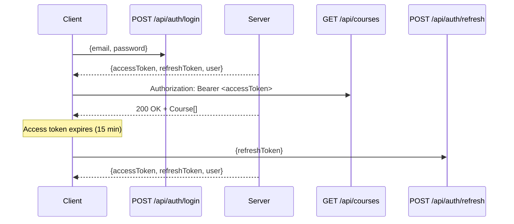

# LMS API Documentation

Complete REST API reference for the Learning Management System.

**Base URL**: `http://localhost:8080/api`  
**Swagger UI**: `http://localhost:8080/swagger-ui.html`  
**OpenAPI Spec**: `docs/openapi.yaml`

---

## Authentication

### JWT Token Scheme

The API uses **JWT (JSON Web Tokens)** with **OAuth2 Resource Server** pattern.

| Token Type | Lifetime | Purpose |
|------------|----------|---------|
| Access Token | 15 minutes | API Authorization (`Authorization: Bearer <token>`) |
| Refresh Token | 7 days | Obtain new access tokens (`POST /api/auth/refresh`) |

### Token Claims

```json
{
  "sub": "1",                    // User ID
  "role": "STUDENT",             // STUDENT or ADMIN
  "type": "access",              // "access" or "refresh"
  "iss": "lms-portfolio",        // Issuer
  "exp": 1705324200,             // Expiration timestamp
  "iat": 1705323300              // Issued at timestamp
}
```

### Authentication Flow



### Role-Based Access Control

| Endpoint Pattern | STUDENT | ADMIN |
|-----------------|---------|-------|
| `GET /api/courses` | ✅ | ✅ |
| `GET /api/courses/{id}` | ✅ | ✅ |
| `POST /api/courses` | ❌ | ✅ |
| `PUT /api/courses/{id}` | ❌ | ✅ |
| `DELETE /api/courses/{id}` | ❌ | ✅ |
| `GET /api/students/me/enrollments` | ✅ | ❌ |
| `POST /api/enrollments` | ✅ | ❌ |
| `GET /api/enrollments/{id}/logs` | ✅* | ❌ |
| `POST /api/enrollments/{id}/logs` | ✅* | ❌ |
| `PUT /api/logs/{id}` | ✅* | ❌ |
| `DELETE /api/logs/{id}` | ✅* | ❌ |

*Only for own enrollments/logs

---

## Endpoints

### Authentication (Public)

#### Register Student
```http
POST /api/auth/register
Content-Type: application/json

{
  "firstName": "John",
  "lastName": "Doe",
  "birthDate": "2000-01-15",
  "email": "john.doe@example.com",
  "phone": "+55 11 99999-9999",
  "password": "SecurePass123"
}
```

**Responses:**
| Status | Description |
|--------|-------------|
| 201 | Created - Returns `AuthResponse` with tokens |
| 400 | Validation error |
| 409 | Email already registered |
| 422 | Under 16 years old |

#### Login
```http
POST /api/auth/login
Content-Type: application/json

{
  "email": "john.doe@example.com",
  "password": "SecurePass123"
}
```

**Responses:**
| Status | Description |
|--------|-------------|
| 200 | OK - Returns `AuthResponse` with tokens |
| 400 | Validation error |
| 401 | Invalid credentials |

#### Refresh Token
```http
POST /api/auth/refresh
Content-Type: application/json

{
  "refreshToken": "eyJhbGciOiJIUzI1NiJ9..."
}
```

**Responses:**
| Status | Description |
|--------|-------------|
| 200 | OK - Returns new `AuthResponse` |
| 400 | Validation error |
| 401 | Invalid/expired refresh token |

---

### Courses

#### List All Courses
```http
GET /api/courses
Authorization: Bearer <accessToken>
```

**Response:** `200 OK` - `CourseResponse[]`

#### Get Course by ID
```http
GET /api/courses/1
Authorization: Bearer <accessToken>
```

**Response:** `200 OK` - `CourseResponse` | `404 Not Found`

#### Create Course (Admin)
```http
POST /api/courses
Authorization: Bearer <adminToken>
Content-Type: application/json

{
  "name": "Spring Boot Advanced",
  "description": "Deep dive into Spring Boot internals..."
}
```

**Responses:**
| Status | Description |
|--------|-------------|
| 201 | Created - `CourseResponse` |
| 400 | Validation error |
| 403 | Forbidden - Admin required |
| 409 | Course name exists |

#### Update Course (Admin)
```http
PUT /api/courses/1
Authorization: Bearer <adminToken>
Content-Type: application/json

{
  "name": "Spring Boot Advanced (Updated)",
  "description": "Updated description..."
}
```

#### Delete Course (Admin)
```http
DELETE /api/courses/1
Authorization: Bearer <adminToken>
```

**Response:** `204 No Content`

---

### Enrollments (Student)

#### List My Enrollments
```http
GET /api/students/me/enrollments
Authorization: Bearer <studentToken>
```

**Response:** `200 OK` - `EnrollmentResponse[]`

```json
[
  {
    "id": 1,
    "courseId": 1,
    "courseName": "Spring Boot Basics",
    "courseDescription": "Learn Spring Boot...",
    "studentId": 1,
    "enrolledAt": "2024-01-15T10:30:00Z",
    "deadline": "2024-07-15T10:30:00Z"
  }
]
```

#### Enroll in Course
```http
POST /api/enrollments
Authorization: Bearer <studentToken>
Content-Type: application/json

{
  "courseId": 1
}
```

**Business Rules:**
- Max 3 active enrollments per student
- 6-month deadline from enrollment date
- Cannot enroll in same course twice
- Course must exist

**Responses:**
| Status | Description |
|--------|-------------|
| 201 | Created - `EnrollmentResponse` |
| 400 | Max enrollments reached / already enrolled |
| 404 | Course not found |
| 409 | Conflict |

---

### Task Logs (Student)

#### List Task Logs for Enrollment
```http
GET /api/enrollments/1/logs
Authorization: Bearer <studentToken>
```

**Response:** `200 OK` - `TaskLogResponse[]`

#### Create Task Log
```http
POST /api/enrollments/1/logs
Authorization: Bearer <studentToken>
Content-Type: application/json

{
  "date": "2024-01-20",
  "category": "PRATICA",
  "description": "Completed exercises for chapter 3",
  "timeSpent": "2024-01-20T01:30:00"
}
```

**Validation Rules:**
- `timeSpent` date must match `date` field
- `timeSpent` time must be in 30-minute increments: `00:30`, `01:00`, `01:30`, `02:00`, etc.
- `category` must be one of: `PESQUISA`, `PRATICA`, `ASSISTIR_VIDEOAULA`

#### Update Task Log
```http
PUT /api/logs/1
Authorization: Bearer <studentToken>
Content-Type: application/json

{
  "date": "2024-01-20",
  "category": "PRATICA",
  "description": "Completed exercises for chapter 3 and 4",
  "timeSpent": "2024-01-20T02:00:00"
}
```

#### Delete Task Log
```http
DELETE /api/logs/1
Authorization: Bearer <studentToken>
```

**Response:** `204 No Content`

---

### Task Categories (Reference)

#### List Categories
```http
GET /api/categories
Authorization: Bearer <accessToken>
```

**Response:** `200 OK`
```json
[
  {"id": 1, "code": "PESQUISA", "displayName": "Pesquisa"},
  {"id": 2, "code": "PRATICA", "displayName": "Prática"},
  {"id": 3, "code": "ASSISTIR_VIDEOAULA", "displayName": "Assistir videoaula"}
]
```

---

## Data Models

### AuthResponse
```json
{
  "accessToken": "eyJhbGciOiJIUzI1NiJ9...",
  "refreshToken": "eyJhbGciOiJIUzI1NiJ9...",
  "tokenType": "Bearer",
  "user": {
    "id": 1,
    "firstName": "John",
    "lastName": "Doe",
    "birthDate": "2000-01-15",
    "email": "john.doe@example.com",
    "phone": "+55 11 99999-9999",
    "role": "STUDENT",
    "createdAt": "2024-01-15T10:30:00Z"
  }
}
```

### CourseResponse
```json
{
  "id": 1,
  "name": "Spring Boot Basics",
  "description": "Learn Spring Boot fundamentals...",
  "createdAt": "2024-01-15T10:30:00Z"
}
```

### EnrollmentResponse
```json
{
  "id": 1,
  "courseId": 1,
  "courseName": "Spring Boot Basics",
  "courseDescription": "Learn Spring Boot...",
  "studentId": 1,
  "enrolledAt": "2024-01-15T10:30:00Z",
  "deadline": "2024-07-15T10:30:00Z"
}
```

### TaskLogResponse
```json
{
  "id": 1,
  "enrollmentId": 1,
  "date": "2024-01-20",
  "category": "PRATICA",
  "description": "Completed exercises for chapter 3",
  "timeSpent": "2024-01-20T01:30:00",
  "createdAt": "2024-01-20T14:30:00Z"
}
```

---

## Error Responses

All errors follow a consistent format:

```json
{
  "status": 400,
  "message": "Validation failed",
  "fieldErrors": {
    "email": "Email already in use",
    "password": "Password must be at least 8 characters"
  }
}
```

### HTTP Status Codes

| Code | Meaning |
|------|---------|
| 200 | Success |
| 201 | Created |
| 204 | No Content (successful delete) |
| 400 | Bad Request - Validation error |
| 401 | Unauthorized - Invalid/missing token |
| 403 | Forbidden - Insufficient role |
| 404 | Not Found |
| 409 | Conflict - Duplicate/business rule |
| 422 | Unprocessable Entity - Semantic validation |

---

## Quick Reference

| Method | Endpoint | Auth | Role | Description |
|--------|----------|------|------|-------------|
| `POST` | `/auth/register` | ❌ | - | Register student |
| `POST` | `/auth/login` | ❌ | - | Login |
| `POST` | `/auth/refresh` | ❌ | - | Refresh token |
| `GET` | `/courses` | ✅ | Both | List courses |
| `GET` | `/courses/{id}` | ✅ | Both | Get course |
| `POST` | `/courses` | ✅ | ADMIN | Create course |
| `PUT` | `/courses/{id}` | ✅ | ADMIN | Update course |
| `DELETE` | `/courses/{id}` | ✅ | ADMIN | Delete course |
| `GET` | `/students/me/enrollments` | ✅ | STUDENT | My enrollments |
| `POST` | `/enrollments` | ✅ | STUDENT | Enroll |
| `GET` | `/enrollments/{id}/logs` | ✅ | STUDENT | Task logs |
| `POST` | `/enrollments/{id}/logs` | ✅ | STUDENT | Create log |
| `PUT` | `/logs/{id}` | ✅ | STUDENT | Update log |
| `DELETE` | `/logs/{id}` | ✅ | STUDENT | Delete log |
| `GET` | `/categories` | ✅ | Both | Categories |

---

## Example: Complete Student Flow

```bash
# 1. Register
curl -X POST http://localhost:8080/api/auth/register \
  -H "Content-Type: application/json" \
  -d '{"firstName":"John","lastName":"Doe","birthDate":"2000-01-15","email":"john@example.com","phone":"+5511999999999","password":"SecurePass123"}'

# 2. Login (or use tokens from register)
curl -X POST http://localhost:8080/api/auth/login \
  -H "Content-Type: application/json" \
  -d '{"email":"john@example.com","password":"SecurePass123"}'

# 3. List courses
curl -X GET http://localhost:8080/api/courses \
  -H "Authorization: Bearer <accessToken>"

# 4. Enroll in course
curl -X POST http://localhost:8080/api/enrollments \
  -H "Authorization: Bearer <accessToken>" \
  -H "Content-Type: application/json" \
  -d '{"courseId":1}'

# 5. List my enrollments
curl -X GET http://localhost:8080/api/students/me/enrollments \
  -H "Authorization: Bearer <accessToken>"

# 6. Log study time
curl -X POST http://localhost:8080/api/enrollments/1/logs \
  -H "Authorization: Bearer <accessToken>" \
  -H "Content-Type: application/json" \
  -d '{"date":"2024-01-20","category":"PRATICA","description":"Chapter 3 exercises","timeSpent":"2024-01-20T01:30:00"}'

# 7. View logs
curl -X GET http://localhost:8080/api/enrollments/1/logs \
  -H "Authorization: Bearer <accessToken>"
```

---

## Rate Limiting & Best Practices

- **Token Storage**: Store refresh token securely (HttpOnly cookie or secure storage)
- **Token Refresh**: Proactively refresh 1-2 minutes before access token expiry
- **Error Handling**: Implement exponential backoff for 429/5xx responses
- **Idempotency**: Use idempotency keys for mutating operations if needed

---

## Support

- **Swagger UI**: Interactive docs at `/swagger-ui.html`
- **OpenAPI Spec**: Machine-readable at `/v3/api-docs`
- **Issues**: Report via GitHub Issues